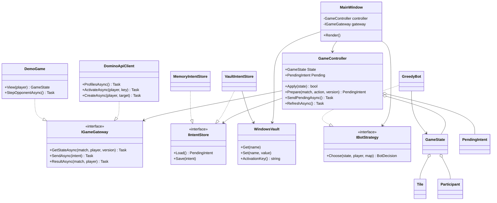
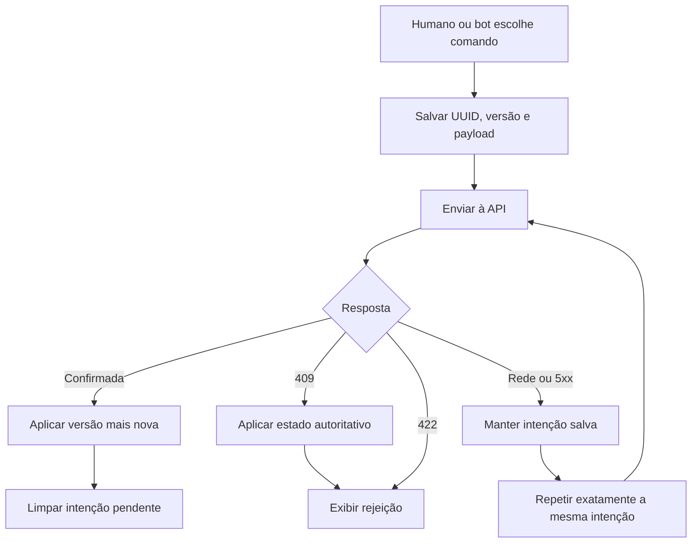

# Diagrama de classes

O GitHub renderiza Mermaid. No VS Code, abra a visualização Markdown; dependendo
da versão/extensões, use a renderização do GitHub para o diagrama.

`Tile`, `Participant`, `GameState`, `ActionRequest`, `PendingIntent` e
`Confirmation` são records. Os DTOs mantêm nomes compatíveis com o contrato;
a serialização usa camelCase e enums numéricos. A API não fornece mãos adversárias.
Os arrays dos DTOs não são mutados pelo controlador; ele troca o estado confirmado.

## Uma intenção até sua confirmação

## Decisões e limites

- `IGameGateway` desacopla a lógica do HttpClient e do simulador.
- `IIntentStore` permite verificar persistência com Moq e usar DPAPI na interface.
- `IBotStrategy` permite trocar a heurística sem alterar transporte/controlador.
- Semáforo serializa operações de jogo; a interface também mantém um indicador de ocupação.
- O estado não é atualizado de forma otimista; a API confirma a jogada.
- DPAPI protege segredos com a conta do Windows, fora do diretório do código.
- WPF/XAML define a apresentação; code-behind coordena eventos e serviços. Não é
  alegado um padrão MVVM completo inexistente no código.
- O simulador é separado; seu bônus simplificado de rodada não afeta a API real.
- O mapeamento da próxima ação precisa de confirmação por lacuna no Swagger.
